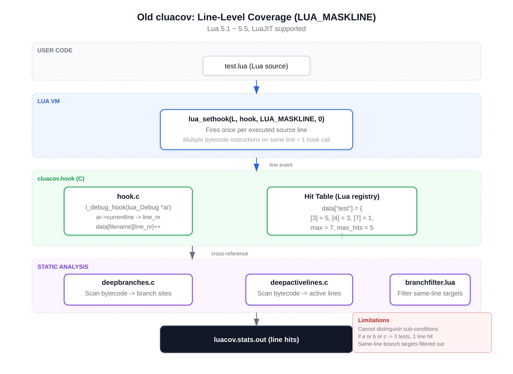
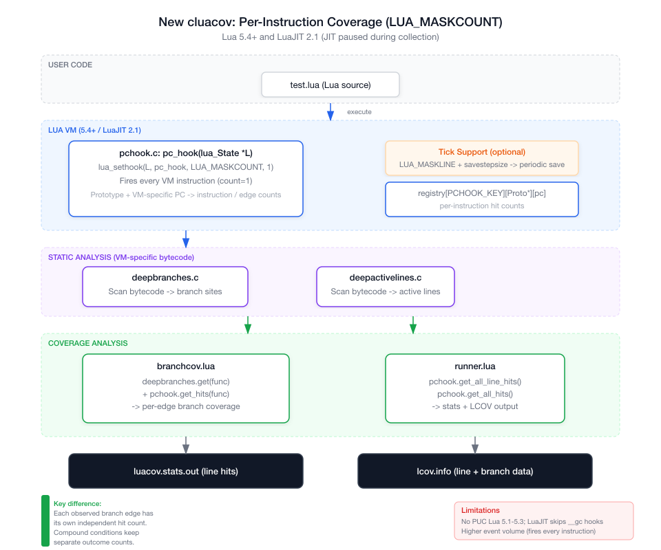
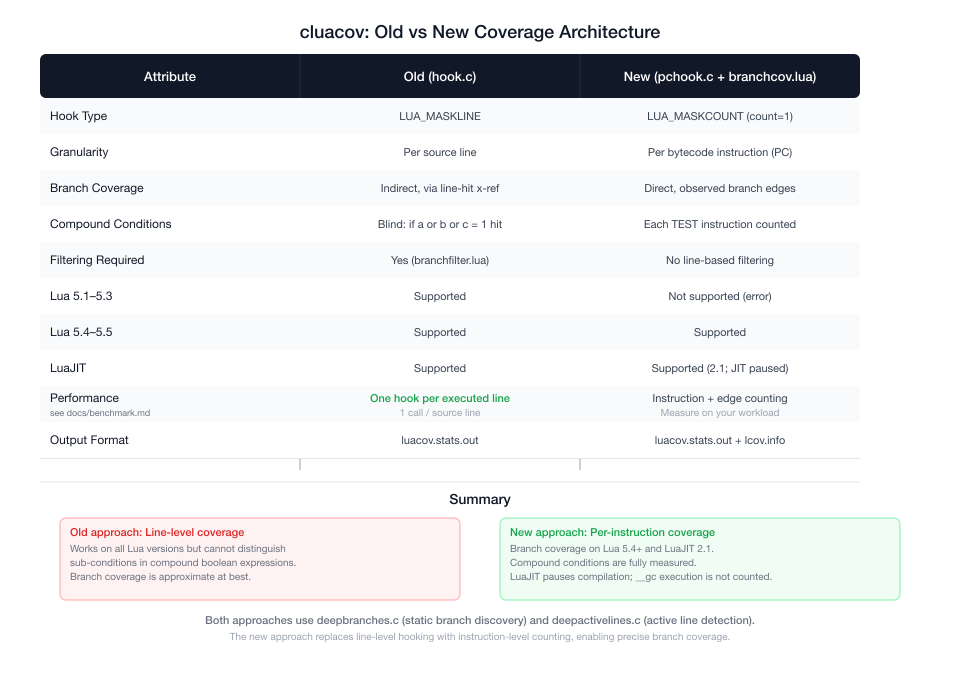

# cluacov

[](./.github/workflows/test.yml) [](https://luarocks.org/modules/lunarmodules/cluacov)

C extensions for [LuaCov](https://github.com/lunarmodules/luacov), improving
performance and reducing number of lines incorrectly marked as missed.

To install using [LuaRocks](https://luarocks.org/), build from a local checkout:

```sh
git clone https://github.com/yeshan333/cluacov.git
cd cluacov
luarocks make
```

cluacov depends on luacov, so `luarocks make` is enough to set up luacov with
extensions.

See [docs/getting-started.md](docs/getting-started.md) for a quick-start guide
on how to add cluacov to your project.

`cluacov.deepbranches` analyzes Lua bytecode to discover branch sites within
functions. It reports conditional branches (`if`/`elseif`/`and`/`or`), numeric
`for` loops, and generic `for` iterators. Combined with LuaCov line-hit data,
it enables branch coverage analysis with LCOV/HTML report generation.

See [docs/branch-coverage.md](docs/branch-coverage.md)
([中文版](docs/branch-coverage-zh.md)) for a detailed guide
on how branch coverage works, the API reference, and how to generate reports.

## Architecture

cluacov has two coverage collection approaches, depending on the Lua version:

### Old approach (Lua 5.1–5.5, LuaJIT)



The old approach uses `LUA_MASKLINE` to fire a debug hook once per executed
source line. It cross-references line hits with static branch discovery
(`deepbranches.c`) to approximate branch coverage. A `branchfilter.lua` module
filters out branches whose targets share the same source line, which cannot
be distinguished at line granularity.

### New approach (Lua 5.4+ and LuaJIT 2.1)



The new approach uses `LUA_MASKCOUNT` with count=1 to fire a C-level hook on
**every bytecode instruction**. Each instruction's program counter (PC) is
recorded independently. Call/return hooks track function entries and distinguish
successive PCs within each invocation, so `branchcov.lua` counts actual branch
edges even when several branches share a target. An optional "tick" mode saves
periodically and also flushes at normal process exit.

### Comparison



| Aspect | Old (hook.c) | New (pchook.c + branchcov.lua) |
|---|---|---|
| **Hook type** | `LUA_MASKLINE` | count=1 + call/return events |
| **Granularity** | Per source line | Per bytecode instruction (PC) |
| **Compound conditions** | Blind: `if a or b or c` = 1 hit | Each TEST instruction counted |
| **Lua 5.1–5.3** | Supported | Not supported |
| **LuaJIT 2.1** | Supported | Supported (JIT paused during collection) |
| **Performance** | Moderate | Measure with edge tracking; [historical benchmarks](docs/benchmark.md) predate it |

On LuaJIT 2.1, use `luajit -lcluacov.runner your_script.lua` for line,
function, and branch coverage. The collector flushes existing traces and pauses
JIT compilation while active, then restores the original JIT state on `stop()`.
See [LuaJIT details](docs/branch-coverage.md#luajit-21) for lifecycle and hook limits.
